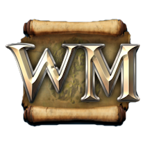
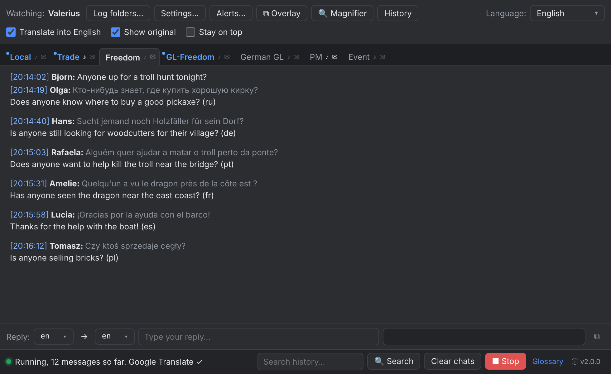

<p align="center"></p>

# BabelWurm

A real-time chat translator for **Wurm Online**. It watches the game's chat logs and shows every channel in its own tab, translated into your language. It runs on **Windows, macOS and Linux**, needs no API keys, and doesn't touch the game client.

**Project page:** <https://wurmmaps.com/BabelWurm> · **Source:** <https://github.com/Jason-Bloomer/BabelWurm> · **Developer & maintainer:** [Jason Bloomer](https://jasonbloomer.com) · **Support:** [support@wurmmaps.com](mailto:support@wurmmaps.com)



## Download

| OS | File | Notes |
|---|---|---|
| Windows | `BabelWurm-Setup-x.y.z.exe` | Installer (Start-menu shortcut, notifications work out of the box) |
| Windows | `BabelWurm-Portable-x.y.z.exe` | Single exe that keeps its settings next to itself. While it runs, a small launcher process sits in front of the app |
| Windows | `BabelWurm-x.y.z-win-x64.zip` | Unzip anywhere and run `BabelWurm.exe` — no installer, no launcher |
| macOS | `BabelWurm-x.y.z-mac.dmg` | Universal (Intel + Apple Silicon). Unsigned: the first time, right-click the app → **Open** |
| Linux | `…-linux-x86_64.AppImage` / `.deb` / `.tar.gz` | `chmod +x` the AppImage and run it |

The builds come from GitHub Actions (`.github/workflows/build.yml`). Push a tag like `v2.0.0` and a release is published with all of them.

## Features

**Chat**
- **Every chat, automatically:** every file in the logs folder becomes a tab, and new chats show up the moment the game opens them. That includes language GLs (`German_GL`, `Spanish_GL`, `Portuguese_GL`, `Non-English_GL`, …), kingdom chats and kingdom GLs from any server or era (`HOTS`, `Freedom`, `GL-Pandemonium`, …), new PM conversations, and the game's own logs (`_Event`, `_Combat`, `_Skills`, …). Monthly, daily and non-rotated log names all work. At start, only chats used in the last month get a tab. A tab with new messages turns blue and a tab with a fired alert turns red. Right-click a tab to hide it (restore it in Settings) or to stop translating it. Combat and Skills aren't translated by default.
- **PMs** share one tab, and each message shows who the conversation is with.
- **Several clients (multi-boxing):** add one client per game copy (Steam, the standalone client, or any folder) and each gets its own top-level tab. **Find automatically** discovers log folders on request. It knows the Steam library folders on every drive, the Steam install on Windows, macOS, Linux, Flatpak and Snap, and the standalone client's `~/wurm`. Your saved paths are never replaced automatically.
- **Only new messages:** existing history is skipped on start. A file that appears later (a new PM conversation, next month's log) is read from the beginning.
- **Mentions:** messages that mention your character are highlighted.
- **Search** across all history (double-click a result to jump to its tab), **Clear chats**, and right-click a message to copy it.

**Translation**
- **Every Google Translate language** (240+), chosen from a searchable list that shows native names. The list also updates itself from Google, so new languages appear without an app update.
- Google Translate first, with **MyMemory** as automatic fallback. After repeated rate-limit replies Google is paused for 30 minutes so the queue never stalls. The status bar shows which service is active.
- Messages already in your language aren't sent for translation. `<Player names>` are never translated, and each translation is tagged with its source language, e.g. `(de)`.
- **Trade prefixes:** WTS → Selling, WTB → Buying, WTT → Trading, PC → Price check, in your language (server tags like `(Cad)` and any letter case are understood).
- **Game currency:** `2g 50s 30c 40i` → "2 gold, 50 silver, 30 copper, 40 iron" in your language, with correct Russian number agreement. It can be switched off.
- **Language chats:** a GL in your own language (e.g. Russian GL for a Russian reader) is shown as-is; GLs in other languages are translated.
- **Game glossary:** Wurm terms are protected before translation and inserted in their exact form, so "nails" never becomes "fingernails". It works for **any language** and ships with about 140 terms (game items, materials, enchantments, gods, plus trade and chat shorthand like WTS, WTB, OBO, ea, brb and afk) translated into Russian, German, Portuguese, Spanish, French and Polish. It has a built-in editor with a live "translate a phrase" preview, and edits made in `babelwurm_glossary.json` apply without a restart.
- **Reply panel:** type in your language and get the translation, which is copied to the clipboard automatically. Right-click a translated message → **Reply** switches the panel to that player's language.

**Overlay mode: a chat window on top of the game**
- Click **⧉ Overlay** (or press **Ctrl+Shift+O** anywhere, even in the game) and the app turns into a compact, see-through panel that stays on top of the game: just the chat tabs and the open chat, so it can replace the game's own chat window. Press it again to go back. History, unread marks and the alert log carry over, and no message is lost during the switch.
- Small side buttons: **Start/Stop**, **Magnifier**, **click-through** (clicks and scrolling over the chat go to the game; Windows/macOS), **background opacity** (100% → 25%), and **back to the normal window**. Drag the panel by its ⋮⋮ handle or the side strip, and resize it from the bottom-right corner.
- Clicking the overlay doesn't take keyboard focus from the game (Windows/macOS; can be turned off in Settings). Alerts, sounds and notifications keep working.
- The overlay remembers its position, size and opacity, and the app reopens in the mode you last used. It works over the game in windowed or borderless-window mode (not exclusive full-screen).

**Magnifier: translate any text on screen**
- Click **🔍 Magnifier**, or press **Ctrl+Shift+M** (⌘⇧M on Mac), and a transparent box appears that stays on top of everything. Drag it by its header over any text on screen (game windows, tooltips, other programs), resize it from the corner grip, and press **Translate** or **Ctrl+Shift+T** (works even while the game has focus). The text is read with OCR and translated into your language; the original is shown above the translation, with a Copy button.
- **Auto** mode re-reads the box every 1.5 s and only re-translates when the text under it changes.
- Text recognition runs **offline** inside the app (Tesseract). The image is upscaled, contrast-stretched and inverted for light-on-dark text first, which reads small game fonts reliably. English is built in; 40 other languages (Russian, German, Chinese, Japanese, Korean, Arabic…) download once (2–10 MB each) when first selected in the box. Recognized text goes through the same translation pipeline as chat (glossary, currency, trade prefixes).
- On Windows and macOS clicks pass through the box to the game. The shortcuts can be changed in Settings.

**Alerts and notifications**
- **Alerts:** a substring in one or more channels (or any channel) triggers a sound, a desktop notification, a red tab, an entry in the **alert log**, and a **last alert** popup in the corner of the screen that doesn't steal focus from the game. Each rule can have its own sound and its own notification text, and a rule fires at most once per 10 seconds. The default rule catches the archaeology message "complete the location details".
- **Per-channel ♪ sound and ✉ notification toggles** on every tab. Right-click a tab to pick its sound.
- Six built-in sounds (generated by `scripts/make_sounds.py`), or your own sound file.

**App**
- **Interface in every language.** Русский, English, Português, Deutsch, Español, Français and 中文 are translated by hand. Every other language is machine-translated with Google Translate the first time you pick it (it takes a few seconds), then cached in `ui-translations/<lang>.json` in the settings folder, where you can correct it by hand. Placeholders are protected and checked; a string that comes back broken stays in English. Right-to-left languages (Arabic, Hebrew, Persian, Urdu…) get a mirrored layout, while chat messages keep their own direction. "Auto" follows your translation language. **Settings → Translate the interface again** refreshes a machine translation, and an app update that changes the English strings re-translates automatically.
- **Auto language:** taken from your Steam client language, otherwise from the OS language.
- **Closing:** the first time you close the window, the app asks whether to keep running in the tray (chats, alerts and magnifier shortcuts keep working) or quit, and can remember your answer (change it later in Settings). **Ctrl+Q**, **Settings → Quit** and the tray menu's **Exit** always quit completely, and quitting is guaranteed to end every process within 3 seconds, so files can be replaced right away.
- **About** page (ⓘ next to the version in the status bar, or the tray menu): version, system info, links to the project page, source code, developer and support.
- Light, dark or system theme; adjustable text size; always-on-top; tray icon; single instance with an **Activate / Replace / Cancel** prompt; update check; debug log; watchdog that restarts stalled background work.
- Every setting is saved the moment you change it.

### Magnifier notes per OS

- **macOS:** the first time you translate, macOS asks for **Screen Recording** permission (System Settings → Privacy & Security → Screen Recording). Allow it and restart the app.
- **Linux:** clicks don't pass through the box (Linux doesn't support that), so move it aside to click what's under it. Without a compositor, transparent windows can't be drawn; the app detects this and hides the box for the instant it reads the screen. Under Wayland, screen capture may show a system permission prompt.
- OCR works best when the box fits the text snugly. Very decorative fonts or text over busy backgrounds may come out imperfect.

## Settings folder

Settings (`babelwurm_config.json`), the glossary (`babelwurm_glossary.json`) and caches live here. **Settings → Open settings folder** opens it.

| OS | Settings folder |
|---|---|
| Windows | `%APPDATA%\BabelWurm` (portable: next to the exe) |
| macOS | `~/Library/Application Support/BabelWurm` |
| Linux | `~/.config/BabelWurm` |

## Building from source

Requires Node.js 20+.

```bash
npm ci
npm start            # build and run
npm test             # unit tests
npm run dist         # package for the current OS into release/
npm run console -- --logs "/path/to/players/<Char>/logs" --lang de   # console mode
```

Windows and Linux packages can be built on their own OS. The macOS `.dmg` must be built on a Mac, or just use the CI workflow, which builds all three.

For offline development, `WCT_DEBUG_CAPTURE=<folder>` saves what the magnifier captured and what OCR saw, and `WCT_MOCK_NET=1` replaces Google/MyMemory with a tiny built-in dictionary, and `WCT_DATA_DIR=<folder>` uses a separate settings folder.

**Changing the app icon:** replace `build/icon-source.png` (transparent PNG, ideally 512 px or larger) and run `python3 scripts/make_icons.py` (needs Pillow). It regenerates every icon size, including a Windows `.ico` that follows Windows' format rules so it also shows in Explorer's small views.

The in-app update check looks at the latest GitHub release of `updateRepo` in `package.json` (`Jason-Bloomer/BabelWurm`). Tag releases `vX.Y.Z` and the CI workflow publishes them.

### Project layout

| Path | What |
|---|---|
| `src/core/` | Platform-independent logic: log parsing and watching, translation chain, glossary, currency, trade prefixes, alerts, config, Steam/Wurm discovery, interface strings |
| `src/main/` | Electron main process: windows, tray, notifications, single instance, last-alert popup, magnifier (screen capture + OCR), updates |
| `src/renderer/` | The UI (Preact + TypeScript) |
| `src/cli/` | Console mode |
| `test/` | Tests (`node --test`) |

Network requests go through Chromium's network stack, so Google sees an ordinary Chrome browser.

## Credits & license

BabelWurm is developed and maintained by [Jason Bloomer](https://jasonbloomer.com). Help and bug reports: [support@wurmmaps.com](mailto:support@wurmmaps.com) (the **About** page's *Copy version info* button gives you the details to include).

MIT License, see [LICENSE](LICENSE).
